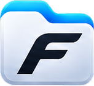
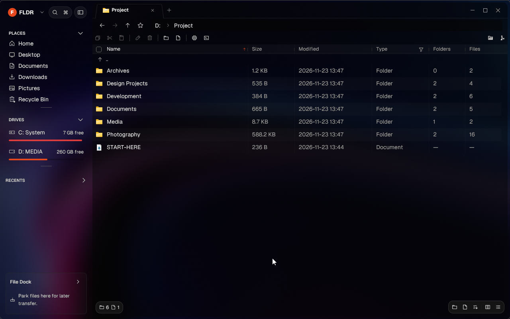
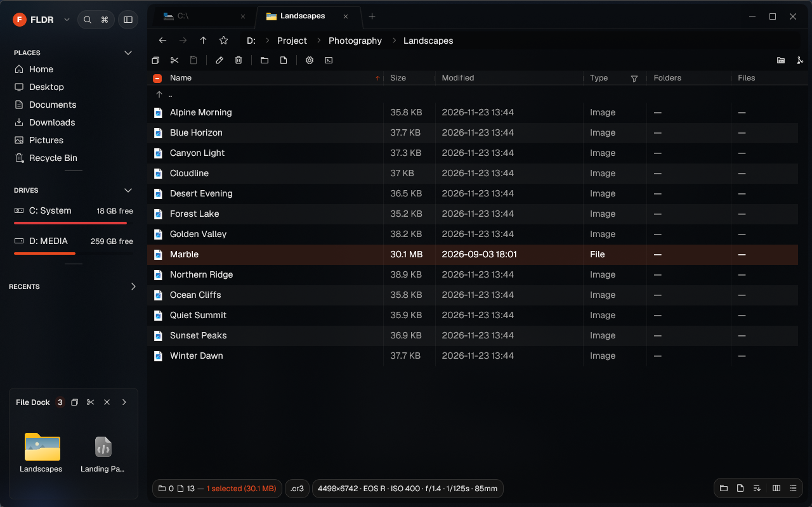
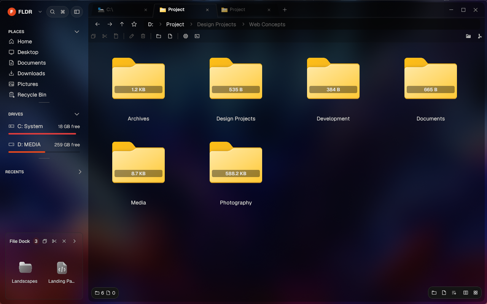
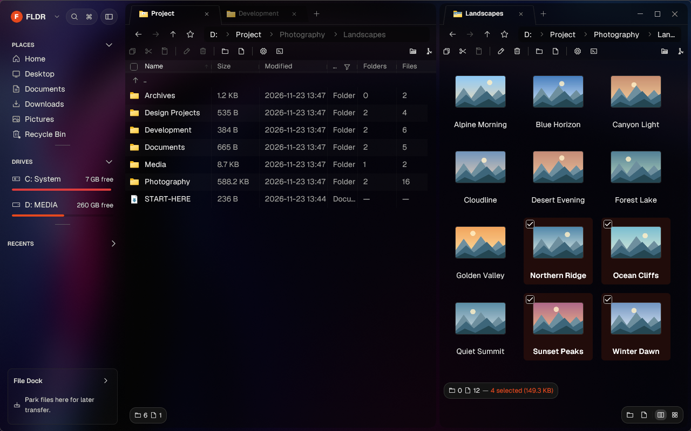
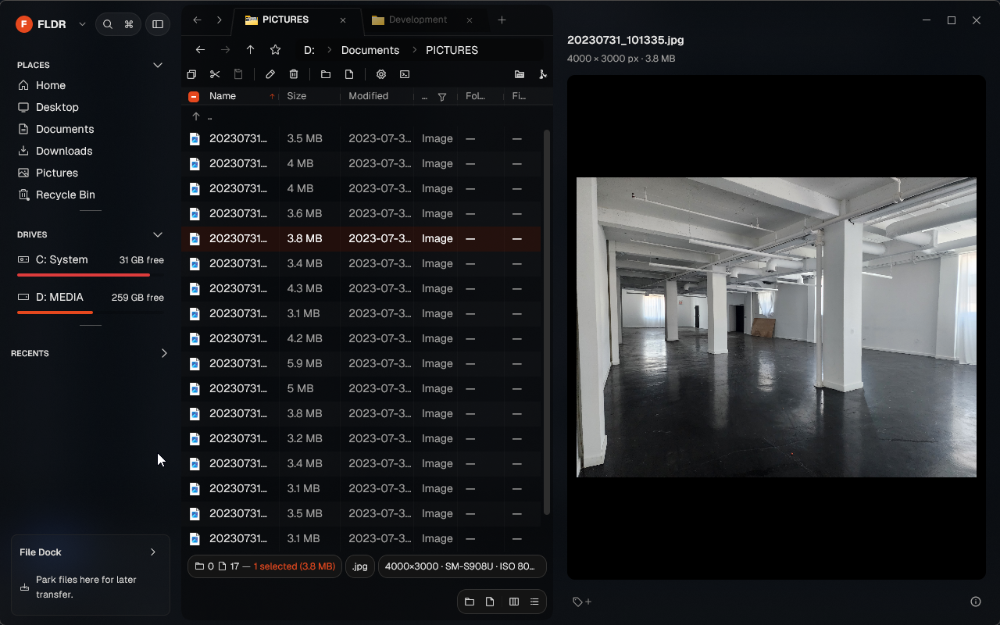
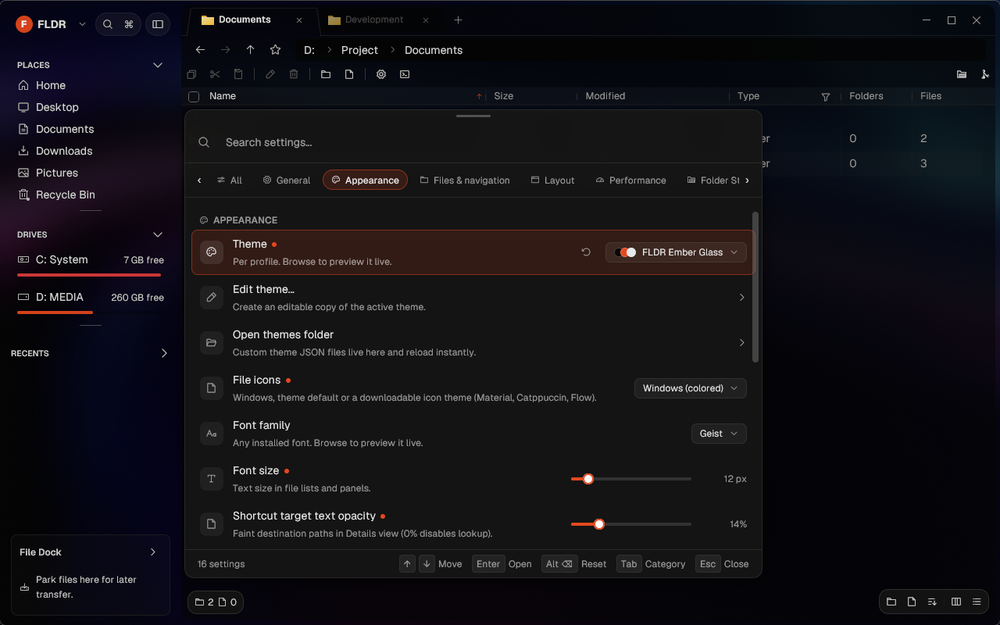
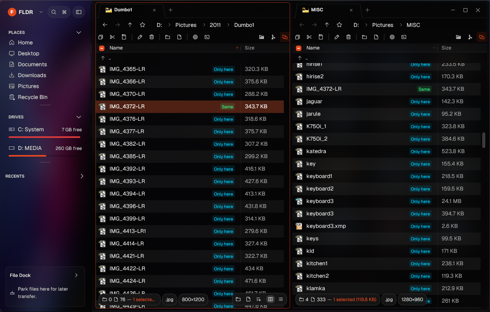

  

  # FLDR

  **A faster, more flexible way to work with files on Windows.**

  Native-feeling file management, useful previews, customizable views, and practical performance improvements—without turning everyday file operations into a science project.

  **Windows 11** · **Rust** · **Local-first** · **Open source**

---

## What is FLDR?

FLDR is a modern file manager for Windows, built on [Atlas](https://github.com/neondeex/atlas-filemanager).

It combines tabs, independent windows, split panes, fast navigation, rich previews, folder comparison, and customizable layouts into one workspace.

The focus is simple: **less waiting, fewer unnecessary clicks, and more control over how files are displayed and managed.**

## Screenshots

### Main interface

### Details view with zebra striping

### Large Icons with folder sizes

### Split-pane browsing

### Image preview

### Appearance and customization

### Folder comparison
*Screenshot coming soon.*

### Independent windows and detachable tabs
*Screenshot coming soon.*

## Highlights

| Feature | Description |
|---|---|
| Workspaces | Tabs, split panes, detachable tabs, and independent windows. |
| Session restoration | Restore previous windows, tabs, and folder layouts. |
| Views | Grid, List, Details, Miller columns, and Tree. |
| Folder preferences | Remember folder-specific views and sorting preferences. |
| Navigation | Breadcrumbs, command palette, quick folder navigation, and drag-and-drop navigation. |
| Finder | Indexed fuzzy search for files and folders. |
| Folder comparison | Compare two directories using metadata or optional SHA-256 content verification. |
| Previews | Images, media, documents, code, and supported archives. |
| Archives | Browse supported ZIP, RAR, 7z, and TAR archives. |
| Network browsing | Navigate SMB servers and shared folders. |
| Cloud folders | Native icon recognition for Dropbox and Seafile folders. |
| File operations | Native Windows copy, move, delete, and context menu integration. |
| Fast Recycle | Optimized recycling of large collections of eligible files. |
| Personalization | Themes, icon packs, zebra striping, row spacing, and customizable layouts. |
| Windows integration | Optional Win+E integration. |

## Performance improvements

FLDR includes targeted improvements to reduce unnecessary work and improve everyday responsiveness.

- Optimized JPEG thumbnail decoding using Windows Imaging Component (WIC).
- Faster directory listing and folder-size calculations.
- Deferred loading of inactive restored tabs.
- Reduced unnecessary startup indexing and background activity.
- Improved background worker lifecycle management.
- Reduced redundant configuration writes.
- Optimized recycling of large file collections.

### Selected benchmark results

| Operation | Before | After |
|---|---:|---:|
| 24 MP JPEG thumbnail | 240 ms | 42 ms |
| EXIF portrait JPEG thumbnail | 342 ms | 43 ms |
| Screenshot thumbnail | 56 ms | 9 ms |
| Directory listing, 20,000 entries | 107 ms | 100 ms |

Fast Recycle was also tested with 20,000 files, followed by hash-verified restoration.

Results reflect specific development benchmarks. Actual performance varies with hardware, file formats, storage, and folder contents.

## Folder comparison

Compare two folders side by side without modifying their contents.

- **Same:** Matching metadata, or matching file contents when SHA-256 verification is enabled.
- **Different:** A detected mismatch.
- **Only here:** An item exists in only one of the compared folders.

Comparison is non-recursive and does not automatically synchronize or modify files.

## Local-first by design

FLDR focuses on local files and explicitly accessed network locations.

- No telemetry reporting.
- No commercial entitlement checks.
- No automatic cloud mounting.
- No automatic update service.
- No bundled cloud synchronization requirement.
- No mandatory Windows Explorer replacement.

Native Windows file operations remain available without additional software.

## Installation

FLDR is distributed as a standalone application.

1. Download a release when available from the [Releases page](https://github.com/digart11/FLDR/releases).
2. Extract the portable ZIP into a folder of your choice.
3. Run `FLDR.exe`.

No installer is required.

Application preferences and profiles are stored separately from the executable. Optional Win+E integration can be configured from FLDR.

## Previews and everyday workflows

Press **Space** on a selected file to open its preview.

FLDR supports common images and media, with additional thumbnail and preview handling for PSD and selected camera RAW formats, including CR2 and CR3 where supported.

Use split panes for working between directories, detach tabs into separate windows, or customize the layout for photography, design, development, and everyday file management.

## Keyboard shortcuts

Shortcuts can be customized in Settings.

| Shortcut | Action |
|---|---|
| `Space` | Preview selected file |
| `Ctrl+Shift+P` | Open command palette |
| `Ctrl+K` | Jump to a folder |
| `Ctrl+T` | New tab |
| `Ctrl+W` | Close tab |
| `Ctrl+Shift+T` | Reopen closed tab |
| `Ctrl+Tab` | Switch tabs |
| `Ctrl+1` through `Ctrl+9` | Switch to a numbered tab |
| `Ctrl+Shift+S` | Split horizontally |
| `Ctrl+Alt+S` | Split vertically |

## License and acknowledgments

FLDR is based on [Atlas](https://github.com/neondeex/atlas-filemanager) and is distributed under the **GNU Affero General Public License v3.0 or later**; see [LICENSE](LICENSE).

- Atlas contributors retain attribution for the original project.
- Earlier modifications are credited to **LW** as documented in [NOTICE](NOTICE).
- FLDR modifications and branding: **digART**.
- Third-party fonts, icons, libraries, and bundled utilities retain their own licenses. See [NOTICE](NOTICE) and the [`legal`](legal) directory.

FLDR is an independent modified project, not an official release of Atlas.
